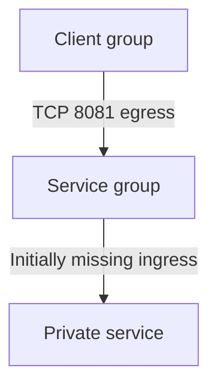

# AWS security-group investigation lab

This is a **synthetic, offline-first** networking exercise. It includes saved example security-group responses, a read-only local inspector, and a Terraform scaffold for an optional future sandbox. It does not provision a VPC, EC2 instance, service, network interface or AWS account. A separate [live EC2 network exercise](live-verification.md) has now verified timeout, scoped ingress recovery and cleanup; it used direct API calls, not this Terraform scaffold.

## The scenario

A synthetic client cannot reach a private service on TCP 8081. In the initial snapshot, the client's egress includes the service security group, but the service group has no corresponding ingress rule. The recovery snapshot adds one rule from that client group to that port. A different synthetic client remains excluded.



This diagram describes the intended scenario. The fixtures are invented JSON, not AWS output collected from a real VPC. See [INC-011](../../incidents/INC-011/brief.md) for triage, alternative hypotheses, sample communication and evidence boundaries.

## Analyze the snapshots without AWS

From the repository root, with Python 3.11+:

```sh
python scripts/sg_inspect.py --snapshot cloud/aws-network/fixtures/broken.json --source-ip 10.24.1.20 --source-sg sg-00000000000000001 --destination-ip 10.24.2.30 --destination-sg sg-00000000000000002 --port 8081
python scripts/sg_inspect.py --snapshot cloud/aws-network/fixtures/recovered.json --source-ip 10.24.1.20 --source-sg sg-00000000000000001 --destination-ip 10.24.2.30 --destination-sg sg-00000000000000002 --port 8081
python scripts/sg_inspect.py --snapshot cloud/aws-network/fixtures/recovered.json --source-ip 10.24.1.21 --source-sg sg-00000000000000003 --destination-ip 10.24.2.30 --destination-sg sg-00000000000000002 --port 8081
```

The fixture expectations are `no_match`, `match`, and `no_match`, respectively. These are security-group rule comparisons under stated assumptions, **not packet tests or proof of end-to-end reachability**. A `match` means both checked directions have a matching allow rule in the supplied snapshot; `no_match` means at least one direction lacks a match; `indeterminate` means a potentially relevant rule could not be resolved, such as prefix-list membership. The command exits 0 for all three analysis results; invalid input exits 2. Do not use its exit code alone as an authorization decision.

## What the inspector can and cannot evaluate

It accepts the full JSON object shaped like AWS CLI `describe-security-groups` output. Provide **every** security group attached to each endpoint, repeating `--source-sg` or `--destination-sg` for multiple groups. The caller supplies the direct source and destination IPv4 addresses and one TCP port. It compares applicable IPv4 CIDRs and security-group references for a new, direct, same-VPC flow. Multiple attached security groups contribute their rules together. Incomplete group fields, missing requested groups and differing VPC IDs are rejected; unresolved prefix lists, group references or missing relevant rule fields are not silently treated as denied. A projected or partial snapshot can therefore be indeterminate even if AWS would allow or deny the flow.

The inspector cannot verify that the supplied IPs or groups actually belong to the intended network interfaces, that a snapshot is current or complete, or that the traffic takes a direct path. It does not evaluate IPv6, prefix-list membership, peering/transit-gateway or middlebox semantics, network ACLs, route tables, connection-tracking edge cases, host firewalls, listeners or application health. It does not query AWS or simulate IAM. Another attached group, different protocol, NAT or a middlebox can change the analysis. Do not use this tool to approve access or modify real infrastructure.

For live work, independently verify the account and region, the network-interface attachments, current security-group rules and private addresses. Inspect the destination listener and health locally; test from an authorized source. Check routes, network ACLs and host firewalls as warranted. AWS Reachability Analyzer may help evaluate a configured path, but it has limitations, does not prove application health and [charges per analysis](https://docs.aws.amazon.com/vpc/latest/reachability/what-is-reachability-analyzer.html). Real group IDs, account IDs, addresses and snapshots can be sensitive; keep them out of public reports.

## Terraform scaffold: not deployed

`main.tf` creates two security groups and one scoped egress rule **if applied** to an existing VPC; it adds the corresponding ingress rule only when `allow_client_ingress = true`. The default deliberately omits that ingress rule. It does not attach the groups to anything or provide a client, service, remote access path, routes or network ACLs. Terraform's AWS provider removes the automatically created allow-all egress rule on new `aws_security_group` resources; review actual deployed rules rather than assuming effective access.

The scaffold is **not a complete live incident environment**. Its narrow rules can disrupt access, including management connectivity, if assigned to real instances. Never attach them to a production or shared workload. Multiple attached security groups can also permit traffic independently, so a live negative control must check all attachments.

Before any real deployment: select a user-authorized disposable account and VPC, region, spending limit and safe access/cleanup plan; understand EC2 and other charges; inspect the exact Terraform plan. Budget notifications are not a hard spending cap. Do not deploy until that decision is made. Terraform state may contain sensitive infrastructure identifiers and must stay private. The Terraform scaffold itself remains undeployed; the separate live API exercise is documented above.

The [Terraform test file](tests/security-groups.tftest.hcl) uses a mocked AWS provider and explicitly runs only `plan` operations. It checks the missing-ingress default, scoped fix and input validation without cloud credentials or AWS resources. `terraform init` still downloads the provider, and adding future tests with a real provider or `apply` could create infrastructure; inspect tests before running them. See [HashiCorp's mocking documentation](https://developer.hashicorp.com/terraform/language/tests/mocking).

On 30 October 2026, [this Terraform CI run](https://github.com/kinz0042/cloud-support-engineering-lab/actions/runs/41021868645) passed formatting, validation and all four mocked plan tests at commit `efe7ba4d81ea5fbf2d6ff74b00d3f0f9a5828251`. The inspector's ten tests also passed in the [75-test PostgreSQL-backed run](https://github.com/kinz0042/cloud-support-engineering-lab/actions/runs/41021476213) at commit `a5a9214c9a79553d463086cbdef85e118eb852b0`. These results establish the checked code and simulated configuration behavior only; they do not establish real AWS reachability or learner competence.

AWS references: [security-group rules](https://docs.aws.amazon.com/vpc/latest/userguide/security-group-rules.html), [statefulness and connection tracking](https://docs.aws.amazon.com/AWSEC2/latest/UserGuide/security-group-connection-tracking.html), and [network ACLs](https://docs.aws.amazon.com/vpc/latest/userguide/vpc-network-acls.html).
