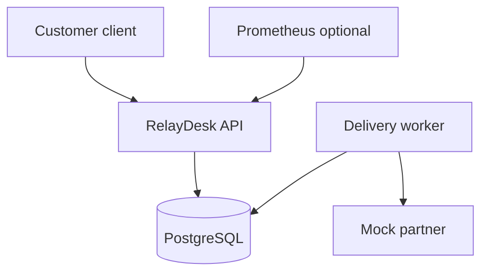

# Architecture and delivery boundaries

## Implemented foundation

A customer client calls a loopback HTTP server. `/health` checks liveness; `/ready` checks the synthetic order dependency. `/v1/orders` checks a bearer credential and reads synthetic data through an order store interface. When the store is unavailable, the authorized request returns a generic 500 and the server records a reason with the same request ID. Each GET receives a generated correlation ID, returned to the client and recorded in structured logs. Storage is still static; no database has been implemented.

## RelayDesk Docker profile (database integration and Compose smoke verified in CI)

A simulated B2B order integration service. Two synthetic tenants submit orders with separate demonstration keys. The API stores each order and one outbox delivery in the same PostgreSQL transaction. A worker leases due deliveries with `FOR UPDATE SKIP LOCKED`, signs a JSON payload, retries failures with capped backoff and marks exhausted attempts dead. The mock partner checks signatures and recognizes repeated event IDs. The API accepts signed callbacks and stores unique event IDs. Local HTTP tests cover tenant isolation, failure paths and signatures. GitHub Actions verifies real PostgreSQL operations. The full Compose smoke test has passed in GitHub Actions.

The API writes an order and an outbox record to PostgreSQL. The worker reads the outbox and sends signed events to the mock partner. A separate signed callback endpoint can be exercised with the callback script. Prometheus scrapes API metrics; API, worker and partner emit logs. The current implementation has no reverse proxy, TLS termination or distributed tracing.

Next delivery order:
1. Extend the verified Compose and PostgreSQL drills with network/TLS and auth-expiry scenarios.
2. Add realistic webhook recovery and durable mock-partner deduplication.
3. External standards-based OAuth/OIDC provider in an optional profile; JWT issuer/audience/expiry/signature checks.
4. Metrics dashboard, external notification and trace correlation. Add a tiny support UI only when it makes an investigation clearer.
5. AWS variant: IAM, private S3, EC2, security groups, CloudWatch; infrastructure code and teardown verification.

Decisions: Python first to read and automate investigations. SQL receives substantial practice. Basic JavaScript/DevTools later for customer integration reproduction; React and Kubernetes await stronger role-specific evidence. Local default, lightweight optional services, no always-on cloud bill.

Resource target (unmeasured): core containers comfortably below 4 GB RAM; measure before adding telemetry. Current laptop/OS must be rechecked before installation.
