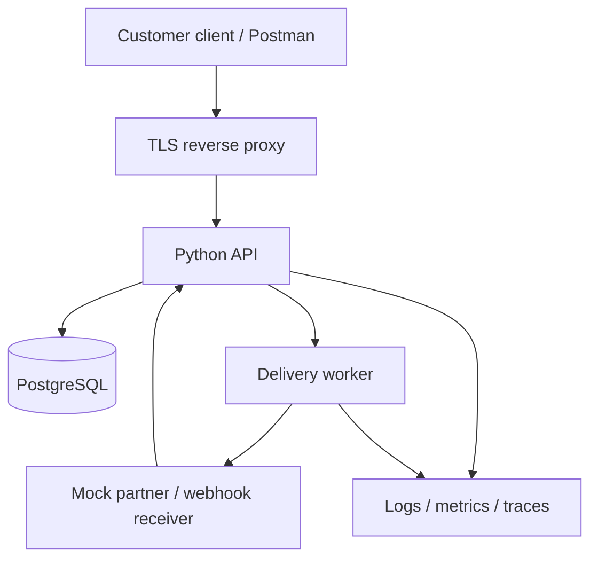

# Architecture and delivery boundaries

## Implemented foundation

A customer client calls a loopback HTTP server. `/health` checks that server; `/v1/orders` checks a bearer credential and returns synthetic data. Each GET receives a generated correlation ID, returned to the client and recorded in structured logs. Storage is currently static.

## Planned flagship: RelayDesk

A simulated B2B order integration service. Two synthetic tenants submit orders; an outbound delivery worker notifies a mock partner. The partner can timeout, return 429, or deliver duplicate callbacks. Tenant isolation and authentication failure must be tested explicitly.

Delivery order:
1. Current HTTP/auth/logging foundation.
2. Docker Compose: Python API, PostgreSQL; migrations, tenant fixtures, CRUD and isolation tests.
3. Outbox records and worker; webhook HMAC verification, bounded retries and idempotency.
4. External standards-based OAuth/OIDC provider in a separate optional profile; JWT issuer/audience/expiry/signature checks. Do not build an authorization server from scratch.
5. Optional metrics/dashboard profile and trace correlation. Add a tiny support UI only when it makes an investigation clearer.
6. AWS variant: IAM, private S3, EC2, security groups, CloudWatch; infrastructure code and teardown verification.

Decisions: Python first to read and automate investigations. SQL receives substantial practice. Basic JavaScript/DevTools later for customer integration reproduction; React and Kubernetes await stronger role-specific evidence. Local default, lightweight optional services, no always-on cloud bill.

Resource target (unmeasured): core containers comfortably below 4 GB RAM; measure before adding telemetry. Current laptop/OS must be rechecked before installation.
